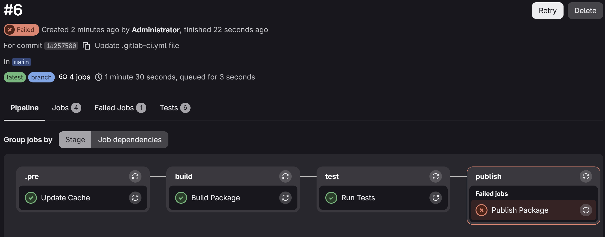

# Девопс 2 Финальное ДЗ
## Выполнил: Шумай Артём

Произвел весь сетап до задания 1. (cамое главное что поднял вмку ./scripts/10-up.sh и создал репу аудит-свц в юишке гитлаба)

## Задание 1:
По условию задания и из ридми аудита создадим нашу сборку, вытянул файлы из counter-backend и сделал минимальные модификации, по заданию. 

```
artem@DESKTOP-NBAE2LL:~/projects/hw_final/audit-svc$ git push
Username for 'http://gitlab.localtest.me:8929': root
Password for 'http://root@gitlab.localtest.me:8929':
Enumerating objects: 28, done.
Counting objects: 100% (28/28), done.
Delta compression using up to 16 threads
Compressing objects: 100% (26/26), done.
Writing objects: 100% (28/28), 57.91 KiB | 14.48 MiB/s, done.
Total 28 (delta 0), reused 0 (delta 0), pack-reused 0
To http://gitlab.localtest.me:8929/demo/audit-svc.git
 * [new branch]      main -> main
 ```

 